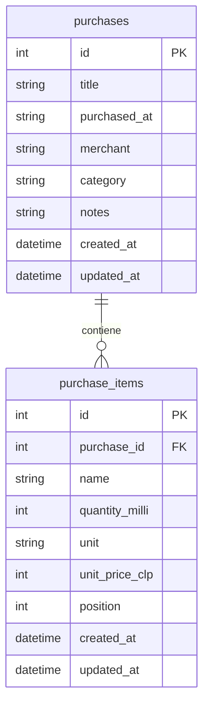

<h1 align="center">Mis Compras</h1>

<p align="center">
  
  
  
  
  
  
</p>

<p align="center">
  Registro local de compras y gastos en pesos chilenos (CLP), para Android e iOS.
</p>

## Descargar

Todavía no hay APK publicado. Las versiones quedarán en [Releases](https://github.com/freddyhcode/mis-compras-app/releases).

## La idea

La app permite crear compras, agregar productos con cantidad, unidad y precio, calcular el total, consultar el historial, ver estadísticas y exportar a Excel. Todo queda en el dispositivo: no hay cuentas, nube, publicidad ni analítica.

- Registrar compras de supermercado, online o de cualquier tienda.
- Guardar qué se compró, cuánto se pagó y cuándo.
- Tener un historial consultable y un resumen de gastos.
- Exportar los datos a Excel cuando el usuario lo pida.

## Requisitos

- Flutter 3.44.8
- Dart 3.12.2
- Android SDK

## Cómo correr el proyecto

```bash
git clone https://github.com/freddyhcode/mis-compras-app.git
cd mis-compras-app
flutter pub get
flutter run -d <dispositivo> --dart-define-from-file=.env
```

Preview web:

```bash
flutter run -d chrome --dart-define-from-file=.env
```

Web usa datos de demo y sirve solo para revisar la interfaz. La validación de seguridad se hace en un APK o dev build.

## Cómo compilar

### Android

```bash
flutter build apk --release \
  --dart-define-from-file=.env \
  --dart-define=APP_MODE=production
```

El APK queda en `build/app/outputs/flutter-apk/`.

### iOS

```bash
flutter build ios --release \
  --dart-define-from-file=.env \
  --dart-define=APP_MODE=production
```

## Variables de entorno

Copia `.env.example` a `.env`:

```env
APP_NAME=Mis Compras
APP_CREATOR=Tu nombre
APP_CONTACT=tu@correo.cl
APP_WEBSITE=https://tu-sitio.cl
APP_GITHUB=https://github.com/tu-usuario
APP_SUPPORT=https://tu-enlace-de-cafe
APP_MODE=development
```

`APP_MODE` puede ser `development`, `demo` o `production`:

- `development`: muestra las herramientas de desarrollo.
- `demo`: las oculta y no usa datos reales.
- `production`: build final, sin herramientas internas.

No pongas secretos en estas variables: quedan dentro del build.

## Verificación

```bash
dart format --set-exit-if-changed .
flutter analyze
flutter test
```

## Base de datos



## Licencia

MIT.
